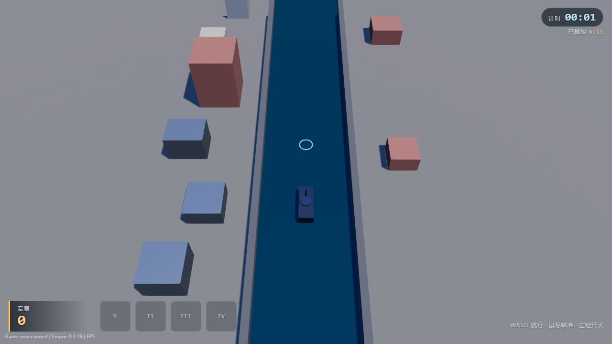
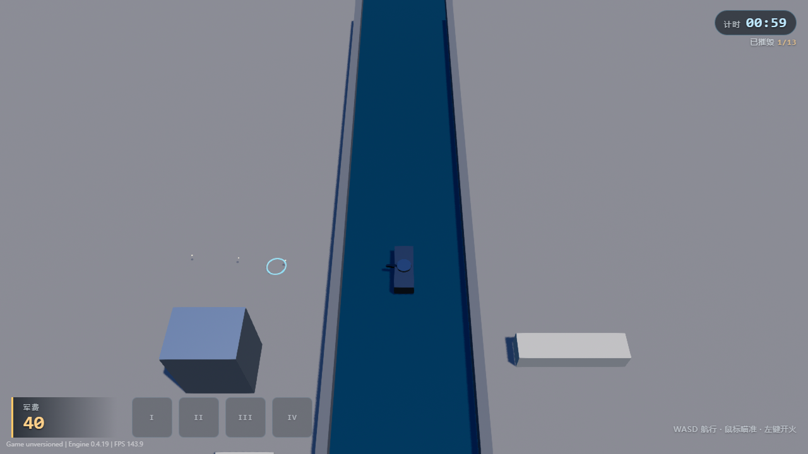

# voxel — 体素战舰破坏

俯视视角的沙盒破坏原型：驾驶一艘体素战舰沿黄浦江北上，用炮火把两岸 13 个设施拆掉，
摧毁即时结算军费。目标在 M0 阶段只有一个——**不靠敌人、不靠特效，光拆楼也要有手感**。

**当前状态**：M0 灰盒。玩法闭环已跑通并通过引擎验收，美术是体素方块。



---

## 已实现 / 未实现

M0 只做五件事，其余一概没有：

| 已实现 | 未实现（有意推迟） |
|:--|:--|
| 战舰在 800×800 上海地图的江面航道内航行 | 敌人与反击 |
| 鼠标指向驱动炮塔转向（含死区、最短弧转向） | 破坏表现：碎块、物理、烟尘 |
| 左键开火，炮弹逐发步进判定，命中扣耐久 | 卡组 / 武器库 / 军备商店 |
| 设施摧毁后军费**即时**到账 | 多地图、程序化生成 |
| HUD 三要素：右上计时、下方军费、四格装载池 | 音效、音乐 |

---

## 操作

| 输入 | 行为 |
|:--|:--|
| `W` `A` `S` `D` / 方向键 | 前进后退、左右平移（横向被夹在江面内） |
| 鼠标移动 | 炮塔追随指向，瞄准环落在落点表面 |
| 鼠标左键（按住） | 开火，4 发/秒 |

战舰**只能走江面**（±36 m 航道），这是设计上的移动走廊，不是限制。

---

## 运行

本工程依赖 [ForgeAX](https://forgeax.com) SDK，且 SDK 必须放在**兄弟目录**：

```
D:\forgeax\
├── engine-sdk-0.4.19\      ← SDK（自行获取）
└── voxel-warship\          ← 本仓库
```

```bash
pnpm install
pnpm exec forgeax project check --json     # 环境自检
pnpm test                                  # 单元测试
pnpm exec forgeax dev start                # 本地开发
pnpm exec forgeax project play scripts/playthrough.mjs --require-ui --json   # 跑验收
```

> [!IMPORTANT]
> `@forgeax/engine` 锁在 `0.4.19`，且 `pnpm-workspace.yaml` 开了 `frozenLockfile: true` /
> `trustLockfile: true` —— 锁文件指向 SDK 自带的离线 store。**没有装对应版本的 SDK，
> `pnpm install` 会失败**，这不是本仓库的问题。



---

## 目录结构

```
assets/
├── game.pack.ts              合成根：children 只有 [physics, city] 两项
├── city/
│   ├── facility-config.ts    ★ 唯一调参面（纯数据 + 纯函数，零引擎 import）
│   ├── scene.pack.ts         整张地图的实体编排（编译期生成，运行期只改 Transform）
│   ├── warship.ts            玩法插件：三段系统 + 读投影
│   ├── camera.ts             俯视跟随相机
│   ├── city.pack.ts          城市装配根，挂 warship + camera
│   ├── city-refs.ts          场景实体解析
│   └── pack-ids.ts           本作三个包的 GUID 权威
├── hud/
│   ├── hud-controller.ts     直接建 DOM 的 HUD（ShadowRoot）
│   └── hud.pack.ts           前端根插件
├── materials.pack.ts         材质（模板条目保留 + 本作追加）
└── geometry.pack.ts          网格（同上）
docs/
├── template-disposition.md   模板处置记录（哪些是样例、哪些是本作的）
└── feedback.md               已复现的引擎/SDK 问题
scripts/playthrough.mjs       M0 验收脚本
```

---

## 架构：判定与表现分离

三段系统，同一份数据，三种职责：

| 系统 | 时钟 | 做什么 |
|:--|:--|:--|
| `voxel-warship-aim` | `Update` | 采样输入、把鼠标射线打成地面交点、驱动炮塔转向 |
| `voxel-warship-sim` | `FixedUpdate` | 推船、开火冷却、炮弹步进与命中结算、军费入账 |
| `voxel-warship-present` | `Update`（`after` 变换传播） | 只把判定位姿写回 `Transform` |

**判定层不认识任何渲染对象**，表现层不参与任何数值计算。后续把灰盒换成体素碎块时，
只需要替换表现层——这条边界在 M0 就是硬约束。

场景实体全部在 `scene.pack.ts` 里**静态编排**完，运行期只改 `Transform`，不做动态实例化。
这样彻底绕开了运行期资产句柄管理，也让"哪些东西存在"在编译期就是确定的。

---

## 调参

所有可调数值集中在 `assets/city/facility-config.ts`，改这一个文件就够：

| 常量 | 含义 |
|:--|:--|
| `MAP` | 地图边长 800、江面半宽 45、航道半宽 36 |
| `FACILITY_TYPES` | 13 种设施的 `hp` / `reward` / `size` / `tone` |
| `FACILITY_PLACEMENTS` | 13 个设施的上海坐标（西岸老城厢、东岸陆家嘴） |
| `SHIP` / `TURRET` / `WEAPON` | 航速、炮塔尺寸、射速、伤害、弹速、弹道寿命 |
| `CAMERA_OFFSET` | 相机吊高 360 m、后置 230 m |

`SHIP` 与 `TURRET` 同时被 `geometry.pack.ts` 用来生成网格——**模型尺寸和炮口起点不会漂开**。

---

## 验收口径

不看"构建成功"，只看四件事：

1. `project play` 通过（脚本通过读投影 `voxel-warship.state` 断言，不靠肉眼）
2. 打开截图，看到要求的画面，自审通过
3. 亲手驱动核心输入并看到结果
4. 以上在重载之后依然成立

当前 `scripts/playthrough.mjs` 覆盖 R1–R5：航行、瞄准、命中摧毁、军费到账、HUD 与引擎一致，
每项各存一张命名截图。

---

## 已知限制

- **地图边界无提示**：战舰在 z = ±382 处被硬夹住，画面上没有视觉边界。
- **瞄准只做地面投影**：瞄准环会贴到目标楼顶，但不做穿墙检测，被前排楼挡住时不会提示。
- **13 栋楼撑不起"城市"密度**：800 m 江面上平均 130 m 一栋，视觉上偏空旷，等美术阶段补。
- **单发伤害 25、居民楼 150 耐久**：6 发一栋，这个节奏还没上实机校准。
